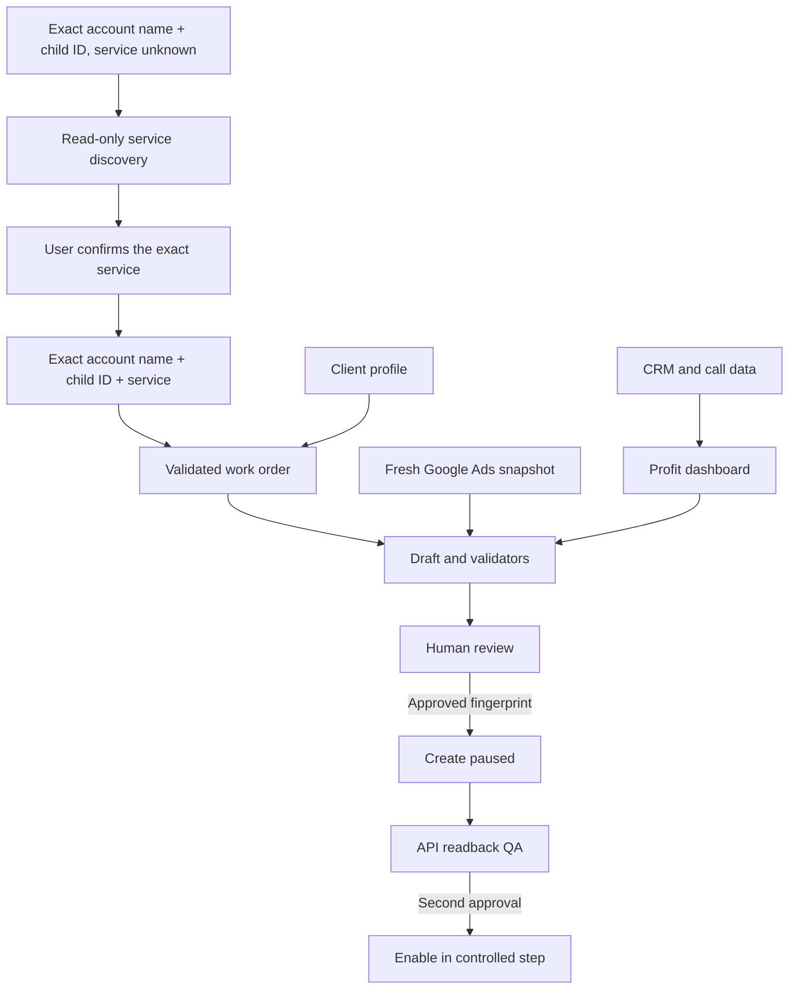

# System Architecture

The repository separates client identity, planning, external mutations, measurement, and presentation. This makes it possible to generate plans and Editor CSVs without credentials, while API writes stay narrowly scoped and reviewable.

## Core data objects

| Object | Purpose |
|---|---|
| `service-discovery.yaml` | Read-only pre-intake identity: exact child account name, child ID, and manager ID with no service yet. Authorizes discovery reads and nothing else |
| `work-order.yaml` | Current task identity: exact child account name, child ID, vertical, exact service, mode, and task scope |
| `client.yaml` | Immutable client identity, economics, service area, permissions, and measurement mapping |
| Campaign plan | Proposed campaigns, ad groups, keywords, ads, locations, schedule, URLs, and assets |
| Account snapshot | Read-only evidence of existing state before changes |
| Approval fingerprint | Binds human approval to an exact normalized plan |
| QA report | Compares created resource IDs and fields to the approved plan |
| Lead/offline event | Connects ad click IDs to qualified lead, sale, revenue, and profit |

## Folder map

| Folder | Purpose |
|---|---|
| `project-instructions/` | Text for ChatGPT Project settings and the client-start flow |
| `clients/_template/` | Copyable client profile, work order, and client workspace structure |
| `config/` | Agency defaults, vertical scope, and reviewed universal negatives |
| `references/verticals/` | Service-specific research guardrails for GM's supported verticals |
| `prompts/` | Claude Code workflows for the five-part operating system |
| `source-material/` | Preserved transcript and supplied Google Docs; not live account truth |
| `src/`, `scripts/`, `schemas/`, `tests/` | Deterministic validation, API helpers, safety checks, and tests |
